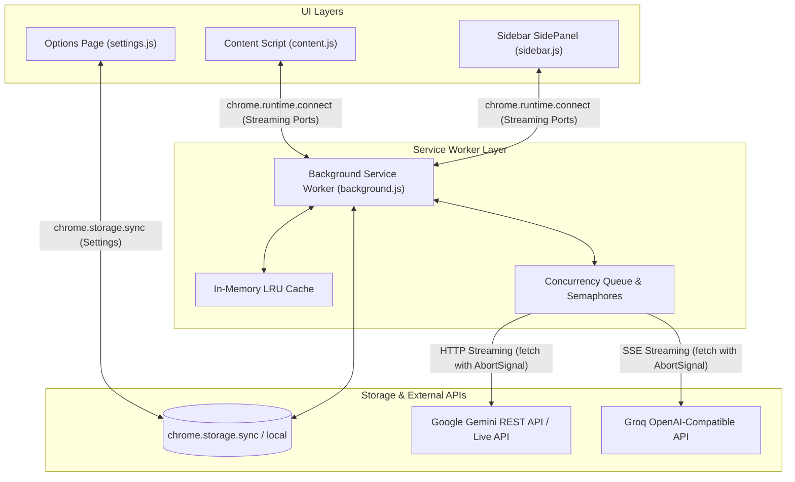

# 🧠 HyperAssistant — Project Technical Context & Architecture Spec

Tài liệu này cung cấp toàn bộ bối cảnh kỹ thuật, kiến trúc hệ thống, giao thức truyền nhận và quy chuẩn mã nguồn của dự án **HyperAssistant (HyperTranslator)** dành cho các AI Coding Assistant và lập trình viên tham gia phát triển dự án.

---

## 🏗️ 1. Kiến trúc hệ thống (System Architecture)

HyperAssistant được xây dựng hoàn toàn theo tiêu chuẩn **Google Chrome Extensions Manifest V3**:



### Các thành phần chính (Components)
* **`background.js` (Service Worker)**: "Trái tim" của extension. Xử lý toàn bộ các kết nối API ra ngoài (Gemini, Groq), quản lý hàng đợi song song (Semaphore), phân giải prompt template, bộ nhớ đệm kết quả (In-Memory LRU Cache), và đăng ký Context Menus.
* **`content.js` (Content Script)**: Chạy trên context của mọi trang web (`all_frames: true`, nhưng Dịch toàn trang chỉ chạy ở top frame). Quản lý giao diện Highlight icon, Hover Box kết quả, Image OCR hover box, và bộ duyệt cây DOM (TreeWalker) để dịch toàn trang.
* **`sidebar.js` & `sidebar.html` (SidePanel)**: Giao diện thanh bên Chrome SidePanel, cho phép dịch nhanh văn bản với dropdown chọn ngôn ngữ đích.
* **`settings.js` & `settings.html` (Options Page)**: Giao diện quản lý cấu hình: API keys, chọn model, tinh chỉnh tham số (temperature, topP, maxTokens), phong cách cảm xúc, ngôn ngữ giao diện (i18n), và kiểm thử kết nối API trực tiếp.
* **`promptconfig.js`**: Trung tâm định nghĩa các mẫu Prompt (Prompt Templates) cho từng tính năng dịch.
* **`constants.js`**: Định nghĩa cấu hình mặc định (`DEFAULT_SETTINGS`).
* **`languages.js`**: Danh sách hơn 100 ngôn ngữ được hỗ trợ.
* **`ui_translations.js` & `utils/i18n.js`**: Hệ thống đa ngôn ngữ cho giao diện extension (English & Tiếng Việt).
* **`utils/theme.js`**: Hệ thống Dark / Light Theme đồng bộ giữa Sidebar và Settings theo cài đặt hệ điều hành hoặc lựa chọn của người dùng.

---

## 📡 2. Giao thức truyền thông (Message Passing & Ports)

Toàn bộ quá trình truyền nhận dữ liệu dịch thuật sử dụng **Long-lived Connections (Chrome Ports)** nhằm hỗ trợ **Streaming thời gian thực (Server-Sent Events / Chunked Transfer)**:

### Tên các kênh Port (`port.name`)
1. **`content_highlight_stream`**: Kích hoạt từ Highlight Hover Box trong `content.js`.
   * Gửi: `{ action: "translateSelectedText" | "summarizeSelectedText", text: "..." }`
2. **`sidebar_stream`**: Kích hoạt từ thanh Sidebar trong `sidebar.js`.
   * Gửi: `{ action: "translateInputText", text: "...", targetLanguage: "..." }`
3. **`content_image_stream`**: Kích hoạt khi người dùng chọn Image Translate từ Context Menu.
   * Gửi: `{ action: "translateImage", imageUrl: "..." }`
4. **`content_page_batch`**: Kích hoạt từ Full Page Translate trong `content.js`.
   * Gửi: `{ action: "translatePageBatch", batchData: [ { id: "ht_node_1", text: "..." }, ... ] }`

### Định dạng thông điệp phản hồi từ Service Worker
* **Chunk nhận được**: `{ action: "chunk", text: "văn bản dịch một phần" }`
* **Hoàn tất**: `{ action: "done" }`
* **Lỗi phát sinh**: `{ action: "error", error: "Thông điệp lỗi chi tiết" }`

### Cơ chế ngắt kết nối an toàn (Graceful Cancellation & AbortController)
* Mỗi kết nối Port đều gắn một `AbortController`. Khi frontend ngắt kết nối (người dùng đóng tooltip, rời trang web, hoặc tắt sidebar), sự kiện `port.onDisconnect` sẽ kích hoạt `abortController.abort()`.
* Lệnh gọi `fetch` đến Gemini hoặc Groq sẽ lập tức bị hủy ở tầng mạng, giúp:
  * Không lãng phí Token / Quota API của người dùng.
  * Ngăn ngừa ngoại lệ `Attempting to use a disconnected port object`.

---

## 💾 3. Cấu trúc lưu trữ dữ liệu (Storage Schema)

Toàn bộ cài đặt người dùng được lưu trữ trong `chrome.storage.sync` dưới khóa `'settings'`:

```typescript
interface HyperAssistantSettings {
  apiProvider: 'gemini' | 'groq';            // Nhà cung cấp API
  apiKey: string;                            // Gemini API Key
  groqApiKey: string;                        // Groq API Key
  modelName: string;                         // Gemini Model ID (mặc định: 'gemini-2.5-flash-lite')
  groqModelName: string;                     // Groq Model ID (mặc định: 'llama-3.3-70b-versatile')
  customModel: string;                       // Tùy chỉnh Model ID tự do
  geminiMode: 'api' | 'live';                // Chế độ Gemini (REST API vs Live WebSocket)
  liveModelId: string;                       // Model ID cho Live API
  temperature: number | null;                // Nhiệt độ ngẫu nhiên (0.0 - 1.0 hoặc null)
  topK: number | null;                       // Top-K sampling (1 - 40 hoặc null)
  topP: number | null;                       // Nucleus sampling (0.0 - 1.0 hoặc null)
  maxOutputTokens: number | null;            // Giới hạn token đầu ra (1 - 8192 hoặc null)
  safetySettings: Array<any>;                // Bộ lọc an toàn của Google Gemini
  defaultTargetLanguage: string;             // Ngôn ngữ đích mặc định (ví dụ: 'vietnamese')
  emotionStyle: 'conversation' | 'serious' | 'humorous' | 'vulgar' | 'furious' | 'touching';
  uiLanguage: 'en' | 'vi';                   // Ngôn ngữ giao diện người dùng
}
```

* **Dữ liệu cục bộ (`chrome.storage.local`)**:
  * `'theme'`: `'dark' | 'light'` (Lưu trạng thái giao diện sáng/tối của người dùng trên máy hiện tại).

---

## ⚡ 4. Kiểm soát luồng & Tối ưu hiệu năng (Concurrency & Optimization)

### 1. Phân luồng ưu tiên (Priority Lane & Concurrency Pool)
* **Interactive Requests (Ưu tiên cao)**: Các thao tác tương tác trực tiếp của người dùng như Highlight Translate, Sidebar Translate, Image OCR Translate được xếp vào luồng ưu tiên cao, xử lý ngay lập tức mà không phải xếp hàng chờ đợi.
* **Batch Requests (Dịch toàn trang)**: Được kiểm soát thông qua `geminiBatchSemaphore` với mức đồng thời tối đa là `3` luồng song song. Điều này tối ưu hóa băng thông mà không vượt ngưỡng Rate Limit (15 RPM) của gói miễn phí Gemini.

### 2. In-Memory LRU Cache
* `background.js` duy trì một bộ nhớ đệm LRU Cache với kích thước tối đa 150 mục.
* Các từ hoặc cụm từ thường gặp khi người dùng bôi đen dịch lại sẽ được phản hồi ngay lập tức trong `0ms` mà không cần gọi ra API bên ngoài.

### 3. Tối ưu hóa DOM Traversal
* Khi người dùng nhả chuột (`mouseup`), hệ thống kiểm tra nhanh `window.getSelection()`. Nếu không có văn bản hoặc độ dài < 2 ký tự, hàm sẽ lập tức thoát, tránh việc kích hoạt `TreeWalker` và ngăn ngừa hiện tượng **Layout Thrashing**.
* Hộp thoại dịch (`hoverBox`) được cố định tọa độ ngay từ lần tính toán đầu tiên, loại bỏ hiện tượng giật cục vị trí (layout shift) trong quá trình streaming.

---

## 🔒 5. Nguyên tắc an toàn & Tiêu chuẩn bảo mật (Security Rules)

1. **Không sử dụng `innerHTML` với dữ liệu không đáng tin cậy**: Toàn bộ kết quả phản hồi từ mô hình AI hoặc văn bản do người dùng nhập vào phải được đưa vào DOM thông qua `textContent` kết hợp với CSS `white-space: pre-wrap; word-break: break-word;` nhằm triệt tiêu hoàn toàn nguy cơ **XSS (Cross-Site Scripting)**.
2. **Bảo toàn chuỗi đặc biệt trong Prompt**: Tuyệt đối không sử dụng `.replace('[inputText]', text)` mà phải dùng replacer function `.replace('[inputText]', () => text)` để tránh việc Javascript hiểu nhầm các ký tự `$`, `$1`, `$&` làm hỏng nội dung văn bản hoặc cấu trúc JSON.
3. **Phạm vi Iframe**: Lệnh Dịch toàn trang chỉ được phép thực thi trên khung cửa sổ cấp cao nhất (`window === window.top`), không tự ý kích hoạt trên các iframe quảng cáo hoặc widget nhúng của bên thứ ba.
4. **Bảo tồn hành vi hệ thống**: Sự kiện phím `Escape` chỉ được can thiệp khi có hộp thoại của HyperAssistant đang mở trên màn hình, không chặn phím Esc của các ứng dụng web khác.

---

## 🧪 6. Hướng dẫn kiểm thử & Xác thực nhanh

* **Kiểm tra cú pháp**: Chạy `node --check <file.js>` trên toàn bộ các tệp `.js`.
* **Kiểm tra i18n keys**: Đảm bảo mọi thẻ có thuộc tính `data-i18n` đều tồn tại khóa tương ứng trong cả hai ngôn ngữ `en` và `vi` của `ui_translations.js`.
* **Kiểm tra tương thích ngôn ngữ**: Dịch thử các đoạn văn bản chứa ký tự tiếng Nhật, Hàn, Trung Quốc, Nga, Tiếng Việt có dấu, và văn bản chứa đơn vị tiền tệ như `$100`, `$50.99`.
